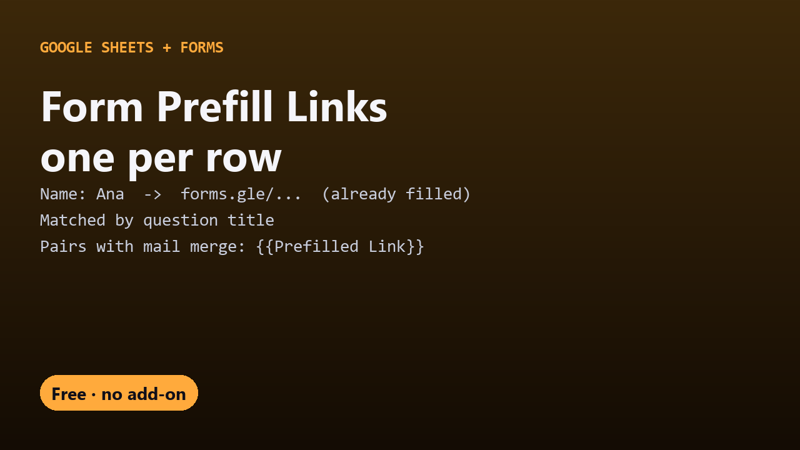

# Free Form Prefill Links for Google Sheets

Make a **pre-filled Google Form link for every row** of a spreadsheet. Each person opens a form that already has their name, ID, team or order number filled in, and only answers the rest. One Apps Script file, no add-on.

- Columns are matched to questions by title, so there's no field-ID hunting
- Works with short answer, paragraph, multiple choice, dropdown, checkboxes (comma-separated), linear scale and date questions
- Re-run any time to refresh every link after you edit the sheet
- Pairs with [Sheets Mail Merge](https://github.com/DecodedXR/sheets-mail-merge): put `{{Prefilled Link}}` in the email and everyone gets their own link

New to this? Read the [step-by-step guide](https://decodedxr.github.io/form-prefill-links/prefill-google-form-from-spreadsheet.html).

## One-time setup (5 minutes)

1. Name your sheet's columns **exactly like the form's questions** (capitalization and extra spaces don't matter). Columns that don't match a question are ignored.
2. **Extensions → Apps Script**, delete the placeholder code, paste in `Code.gs`, save.
3. Reload the sheet. A **🔗 Prefill** menu appears.
4. **🔗 Prefill → Make Prefilled Links** and paste the form's **edit** link, the one in the address bar of the form editor. Google asks for permission the first time ("Google hasn't verified this app" → **Advanced → Go to (your project name) → Allow**; it's your own script).

A **Prefilled Link** column fills with one link per row.

## Notes

- You need edit access to the form, because Google only builds prefilled links for forms you can edit.
- For **checkbox** questions, separate choices with commas: `Red, Blue`.
- For **multiple choice** and **dropdown**, the cell must match one of the choices exactly, unless the question has an "Other" option.
- Grid, time and file-upload questions can't be prefilled this way and are left blank.
- Prefilled answers are only suggestions. Respondents can still change them before submitting.
- **Change Form** switches to a different form.

## More free Google tools

- [Form Auto-Reply](https://github.com/DecodedXR/form-auto-reply): your own email to every Google Form respondent.
- [Sheets Mail Merge](https://github.com/DecodedXR/sheets-mail-merge): a personalized email to every row.
- [Sheets Doc Merge](https://github.com/DecodedXR/sheets-doc-merge): one PDF per row from a Google Docs template.
- [Sheets to Calendar](https://github.com/DecodedXR/sheets-to-calendar): rows become Google Calendar events.
- [Sheets Deadline Reminders](https://github.com/DecodedXR/sheets-deadline-reminders): automatic emails before a due date.

## License

MIT. See `LICENSE`.
